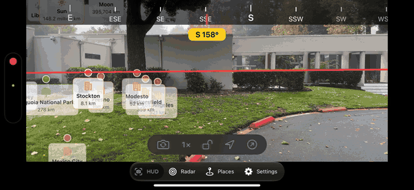
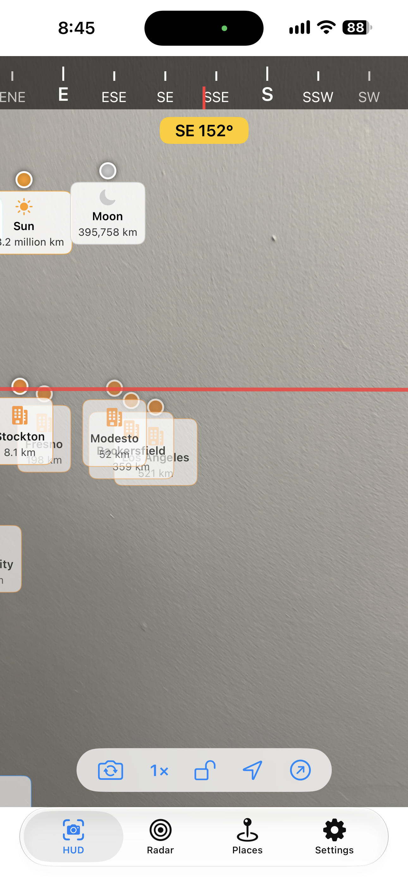
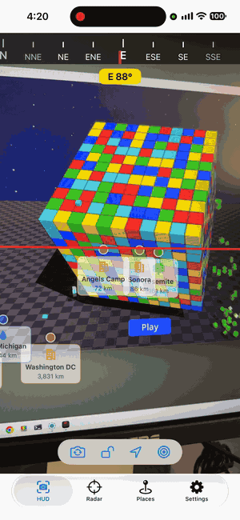
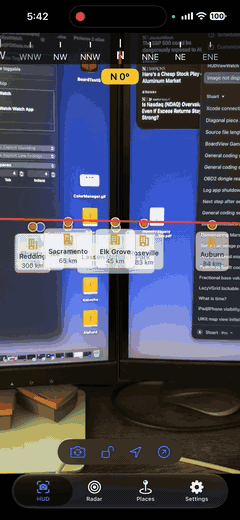
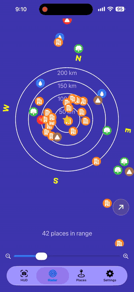
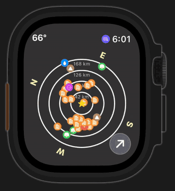
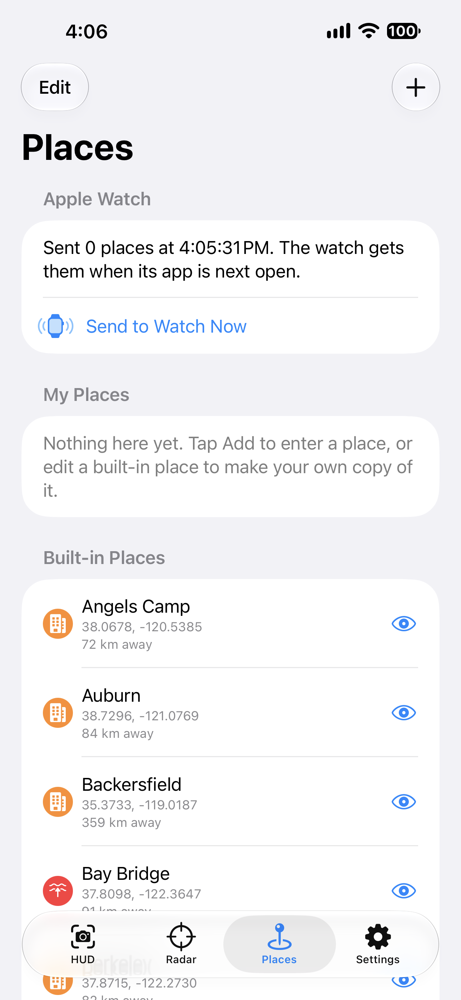
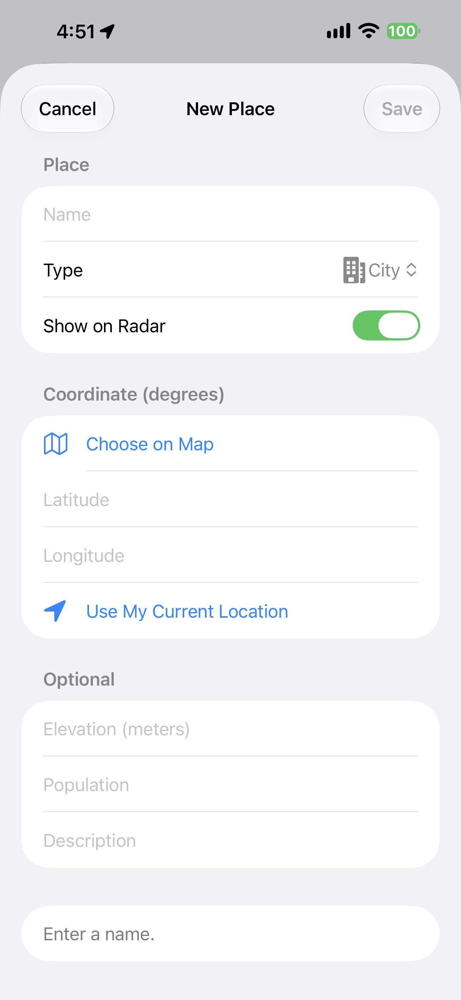

# HUDViewWatch
November 2026\
Stuart Rankin

HUDViewWatch shows you what is around you and which way it lies. On an iPhone, hold the phone up and named places (cities, mountains,
lakes, bridges, your own favorites) appear in the camera view exactly where they are, each with its distance. On an Apple Watch, the same
places appear as a radar around you. Pick one place and either device can track it with an arrow. If you turn them on, the iPhone can also
show the Sun, the Moon, the constellations and some galaxies, where they are in the sky right now.

A *point of interest* (POI, or just "place" in the apps) is anything with a name and a spot on the map. The app ships with a set of
built-in places for testing, and you can add your own.

\

*On the iPhone: places over the live camera view, upright and sideways.*

*On the Apple Watch: the same places on a radar. The Digital Crown zooms. The radar turns as you turn.*

## Getting started
1. Install both the iPhone app and its watch app.
2. Allow **Location** and, on the iPhone, **Camera** when asked. The app needs your location to measure distances and your compass to
   know which way you face.
3. Open the iPhone app. It starts on the HUD tab. Hold the phone up and look around.
4. Open the watch app. The radar shows the same places.
5. Open the **Settings** tab on the iPhone to choose your units and the radar's range, and to turn on the Sun, Moon, constellations and
   galaxies. Changes take effect at once, and the ones that matter to the watch are sent to it.

## The HUD (iPhone)
The HUD is the camera view with information drawn over it.

1. **Compass bar.** Across the top, the sixteen compass points and the bearing you are facing.
2. **Heading.** The yellow label below it gives your heading in degrees and the nearest compass direction.
3. **Horizon line.** The red line is the true horizon: it stays level with the Earth, not with the phone, so it tilts when you tilt the
   phone. (In the picture it is at a slight angle because the phone was held at a slight angle.)
4. **Places.** Each place is a dot at the exact spot where it lies, with a card below it showing its icon, name and distance. Places
   are placed as the camera would see them: a place at your own height sits just under the horizon line, a high mountain sits above
   it, and the farther away a place is, the lower the curve of the Earth drops it. Farther places are drawn a little fainter.
   A place with no elevation entered is treated as being at sea level. There is no distance limit: a place on the far side of the
   Earth is drawn too, below the horizon, so aim the camera down at the ground to find it. (The point exactly opposite you on the Earth
   is straight down.)
5. **Toolbar.** The floating bar near the bottom has five buttons, left to right:
   - **Switch camera** between the back and selfie cameras. The selfie camera shows the horizon but no places.
   - **Wide view.** Shows **1×** and switches the back camera to its ultra-wide lens (**0.5×**) and back. The wide lens sees about twice
     as much, so more places fit on the screen and they sit closer together, in their true directions. The button is dimmed on a phone
     without an ultra-wide camera and is hidden while the selfie camera is in use.
   - **Lock horizon.** Holds the line level in the middle of the view and puts every place on it, whatever its height or distance.
   - **Show location.** Opens a card over the camera with your heading (direction and degrees), your latitude and longitude to five
     decimal places, and your altitude followed by the GPS's accuracy ("±"). It reads "Heading unavailable" or "No location" if the phone
     has none yet. Tap the card to close it.
   - **Pointer mode.** Tracks one place with an arrow. Its VoiceOver name is **Track Selected Place**. See [Pointer mode](#pointer-mode).
6. **Tabs.** The bar at the very bottom switches between HUD, Radar, Places and Settings.

Places are drawn wherever the camera points, including straight down at the ground or up at the sky. Held nearly flat the horizon line
is far out of view, but the places are still there. The HUD works in portrait and landscape.

### Sun, Moon, constellations and galaxies
Four switches in Settings (all off by default) add the sky to the HUD. Each object is drawn like any other place: a dot where it is, with
a card below it.

- **Sun and Moon.** The cards give their distance (the Sun in millions of kilometers or miles). Tap the Moon's card to see how much of
  it is lit and whether it is waxing or waning.
- **Zodiac constellations.** The twelve (Aries to Pisces) are each marked at their middle, which is only approximate because the
  constellations are large. They have no distance. Tap one to see its sign.
- **Other constellations.** Carina, Ophiuchus, Orion (marked at its belt), the Big Dipper, the Little Dipper and the Southern Cross. The
  Dippers are patterns inside Ursa Major and Ursa Minor, and the card says so.
- **Galaxies.** The Andromeda galaxy and the Large and Small Magellanic Clouds (LMC and SMC) show a spiral symbol and their real
  distance in light-years, for example "2.5 million light-years".
- **Where they are.** From the time and your location, like the compass: no data connection is needed. They are placed by direction and
  height above the horizon, and are never dropped by the "Most places shown" limit.
- **Below the horizon.** Aim down and you will find what is on the other side of the Earth, faded. Tapping any of them shows its direction
  and how many degrees above or below the horizon it is. Pointer mode works with them too.

### Tapping a place
Tap a place to select it. Its card grows and widens to show more: what kind of place it is, the bearing to it, its elevation and its
population, where known, and any note you gave it. Tap another place to switch to it; the first one goes back to normal. Tap anywhere
that has no place to put the card back. The selection is shared with the Radar tab, so the place you pick here is highlighted there too.

## Radar (iPhone)
The Radar tab is the same radar as on the watch, with more room. Your position is the star at the center, and the rings
are distances. North is marked around the edge, and the radar turns as you turn so that the top is the way you are facing.

- Zoom with a pinch or with the slider at the bottom.
- Tap a place to select it. Its name and distance appear below the radar.
- With nothing selected, the line below the radar says how many places are in range.
- The round arrow button in the lower right of the radar turns [pointer mode](#pointer-mode) on and off, exactly as on the watch.

## Apple Watch
The watch shows the radar full screen. Turn the Digital Crown to zoom. The top of the radar is the way the watch faces.

- With no place selected, the upper left shows your heading in degrees.
- Tap a place to select it. Its name and distance replace the heading in the upper left.
- The round arrow button in the lower right turns pointer mode on and off: gray when it is off, yellow with a white ring when it is on.
  See [Pointer mode](#pointer-mode).

The watch has the built-in places, and your own places, hidden places, range and units are sent to it from the iPhone (see
[Places](#places)). The watch keeps working with the last information it received. Settings are changed on the iPhone only.

## Pointer mode
Pointer mode tracks one place you choose with an arrow, and keeps tracking it as you move. The control that turns it on is called
**Track Selected Place**; VoiceOver reads it with its state, on or off. It works on the iPhone HUD, on the iPhone Radar
tab and on the watch. The two iPhone tabs share the mode and the chosen place: turn it on in one and it is on in the other. The radar
on the iPhone and the radar on the watch draw the same arrow.

How it works on both:
1. Turn pointer mode on. Nothing changes yet, except that a short hint asks you to tap a place.
2. Tap a place. The other places disappear and the arrow appears.
3. To choose a different place, tap the place's circle to let go of it. The other places come back and you can pick another.
   A stray tap elsewhere is ignored, so you do not lose the arrow by accident.
4. Turn pointer mode off. The app forgets the place, so next time you turn it on you choose again.

### On the iPhone HUD
The pointer button is the circled arrow at the right end of the HUD toolbar. It is filled in while the mode is on.

- **Place in view:** the place keeps its dot, and a bright **yellow** arrow comes in from the middle of the screen and stops just
  short of the dot. A small card behind the arrow gives the place's name and distance.
- **Place out of view:** the arrow turns **red** and sits at the edge of the screen on the side you need to turn toward. If the place
  is behind you, it points the shorter way round. Turn that way and the arrow slides in until it is on the place and turns yellow.
- **Lock horizon on:** every place is on the horizon line, so the arrow only tells you left or right.

### Radar View
The pointer button is the round button in the lower right corner (on the iPhone, in the lower right of the radar, just above the
name and distance). It is gray when the mode is off, and solid yellow with a white ring when it is on.

\

Radar view on an Apple Watch.\

- **With the mode on and no place chosen**, a short hint asks you to tap a place: in the upper left on the watch, and below the radar
  on the iPhone. (On the iPhone HUD it appears under the heading label.)
- **With a place chosen**, a yellow arrow runs from the center of the radar to the place's circle. Your star and the other places
  are hidden. The place's name and distance stay where they always are: in the upper left on the watch, below the radar on the iPhone.
- **The number behind the arrow's base** (on a dark pill) is the direction of the place measured from the way the watch faces:
  0° is straight ahead, 90° is to the right. Turn the watch (or the phone) until it reads 0° and you are facing the place.
- **Places beyond the outer ring** are drawn on the ring, so the circle is always visible. Zoom out with the Digital Crown to see how
  far away it really is.

## Places
The Places tab is where you manage the list of places. Changes are sent to the watch automatically; **Send to Watch Now** resends
everything if you want to be sure.

- **My Places** are the ones you made.
- **Built-in Places** are a set of test places (cities, mountains, parks and so on). Tap the eye icon next to any place to hide or
  show it on the HUD, the radar and the watch.
- **Edit** and swipe to delete places. Deleting a built-in place only hides it; **Reset Built-In Locations** brings them back.
- **Add** (the **+** at the upper right) opens the place editor.

In the editor, give the place a name and a kind, then set its position by hand, with **Choose on Map**, or with **Use My Current
Location**. Elevation, population and a short note are optional. Which of them make sense depends on the kind: a national park does
not need a population.

## Settings
Settings are on the iPhone only, in the **Settings** tab (the gear). They apply as soon as you change them. The ones that matter to the
watch are sent to it; the ones marked "iPhone only" change only the iPhone. The four sky switches are grouped under **Sky**.

| Setting | What it does |
| :--- | :--- |
| **Maximum range** | Places farther than this are not shown on the radar and the watch. It is also the distance of the outer ring when the radar is zoomed all the way out. Sent to the watch. The HUD shows places at any distance. |
| **Crop places to range** | On: the iPhone radar shows only places inside the outer ring. Off: places beyond the ring are drawn outside it and move as you zoom. This affects only the iPhone radar; the watch always keeps places inside the ring. |
| **Distances** | Kilometers and meters, or miles and feet, for every distance in the HUD, the radar and the watch. Sent to the watch. |
| **Most places shown** | The most places drawn on the HUD at once, nearest first. Lower it if the HUD feels slow. |
| **Show Sun and Moon** | Adds the Sun and the Moon to the HUD. iPhone only. |
| **Show zodiac constellations** | Adds the twelve zodiac constellations to the HUD. iPhone only. |
| **Show other constellations** | Adds Carina, Ophiuchus, Orion, the Big Dipper, the Little Dipper and the Southern Cross. iPhone only. |
| **Show galaxies** | Adds the Andromeda galaxy and the Large and Small Magellanic Clouds. iPhone only. |
| **Lock horizon** | Holds the horizon line level in the middle of the HUD and puts every place on it. Off by default: the line follows the real horizon. |
| **Apple Watch** | The status of the last information sent to the watch, so you can see that your changes have gone across. |

## Requirements
iOS and watchOS 27. The app needs permission to use your location, and on the iPhone your camera.

- **The iPhone app** uses the phone's compass, motion sensors, GPS and camera.
- **The watch app** uses the watch's own compass and location; it does not borrow them from the iPhone. It gets your places, range and
  units from the iPhone.

The app works best away from metal and metallic structures, which can throw off the compass.

## Limits and accuracy
HUDViewWatch is a guide, not a survey instrument. It is **not expected to be fully accurate**, because of what the hardware in a phone
and a watch can measure. Treat what you see as pointing you the right way, not as an exact position.

- **Compass.** A phone's compass is good to a few degrees at best, and metal, magnets and electronics nearby make it worse. Any error in
  the heading shifts every place sideways by the same amount, so places can sit a little to one side of the real thing. A watch's compass
  is smaller and less steady still.
- **Motion sensors.** The tilt readings are noisy. The app smooths them so the horizon does not tremble, which also means it takes a
  moment to settle after you move the phone.
- **GPS.** Your position is good to some meters outside and worse in cities, under trees and indoors. Altitude is the least accurate
  reading of all, and it decides how high a place sits above the horizon line.
- **Camera.** The app uses the field of view the lens reports. The real picture can differ from it, especially toward the edges, and
  most of all with the ultra-wide (0.5×) lens. A marker near the edge of the picture may not line up exactly with the real thing.
- **The Earth.** The horizon is a geometric one. Hills, buildings and the bending of light in the air are not modeled. A place with no
  elevation entered is treated as being at sea level.
- **The sky.** The Sun and Moon are placed with formulas good to a small fraction of a degree, but the constellations are marked at
  approximate centers, are not corrected for the slow drift of the stars, and the bending of light near the horizon is ignored. Objects
  below the horizon are shown where they would be through the Earth.

## Testing notes
The camera, motion sensors and compass do not exist in the Simulator. There the HUD shows a black background, a level horizon and a
heading of 0°, so the places can still be seen and tapped. The projection and horizon math, and the positions of the Sun, the Moon and the
constellations (checked against known events such as the equinox and the phases of the Moon), are covered by unit tests. The live camera
view, the compass and the wide (0.5×) lens need a real iPhone to check.

In the Simulator the heading is fixed at north and the camera is level, so only what lies north of you and near the horizon appears. To
see the sky there, turn on the Sky settings and choose a location (Features ▸ Location) where something is just above the northern
horizon at that moment.

**The antipodal test place.** One of the built-in test places, **Static Antipodal**, is exactly opposite Stockton, California
(37.9577° N, 121.2908° W): its coordinates are 37.9577° S, 58.7092° E. From Stockton it is about 20,015 km away and **straight down**, so
it is the place to test the far side of the Earth. On a real iPhone at Stockton, hold the phone flat, face up, so the back camera looks at
the ground; the place should be in the middle of the view. A few kilometers away it is still within a fraction of a degree of straight
down. (The Simulator cannot tilt the camera, so it cannot show this.)

---

## Development notes
HUDViewWatch merges two earlier apps, for iPhone and Apple Watch:

- **HUDViewUI** (UIKit): a camera view with a horizon line, a compass bar and places drawn over the picture.
- **POIView2** (SwiftUI): a radar of places for iPhone and Apple Watch, with an editable list of places that is sent to the watch.

It is the successor to HUDView, HUDViewUI and POIView2, and was built with Claude and a great deal of testing. HUDViewUI's screens were
rewritten in SwiftUI. The only UIKit left is the camera preview layer, which SwiftUI cannot show by itself (`CameraPreview.swift`), and
reading the interface orientation. Route waypoints from HUDViewUI are not included, as in POIView2.

### What came from where
| Feature | From |
| :--- | :--- |
| Camera view, horizon line, horizon lock, selfie camera | HUDViewUI |
| Compass bar (16 points), location card | HUDViewUI |
| Earth-curvature elevation, pinhole projection of places | HUDViewUI (`Shared/HUDMath.swift`, now tested) |
| Metric / imperial distances | HUDViewUI (`Shared/DistanceUnit.swift`) |
| In-range count on the radar | HUDViewUI |
| Place descriptions and the extra built-in places | HUDViewUI |
| Place list, editor, map picker, edited copies of built-ins | POIView2 |
| Show/hide a place, overlap culling, range and crop settings | POIView2 |
| Watch app and WatchConnectivity sync | POIView2 |
| Pointer mode, tap-to-expand place cards, landscape, wide (0.5×) view | new in HUDViewWatch |
| Sun, Moon, constellations and galaxies (`SkyMath.swift`, `SkyObjects.swift`) | new in HUDViewWatch |

### Layout
- `Shared/` is compiled for both iPhone and watch: models, store, radar, `HUDMath` (camera and horizon math), units, sync.
- `HUDViewWatch/` is iPhone only: the tabs, camera, motion, HUD screen, and the sky (`SkyMath` for where the Sun, Moon and stars are,
  `SkyObjects` for the list of what to show).
- `HUDViewWatch Watch App/` is the watch screen.
- `HUDViewWatchTests/` holds the unit tests (radar, store, settings, HUD math, sky, units, pointer mode).
