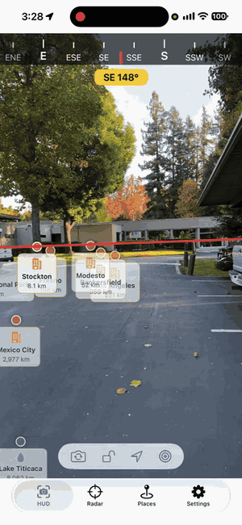
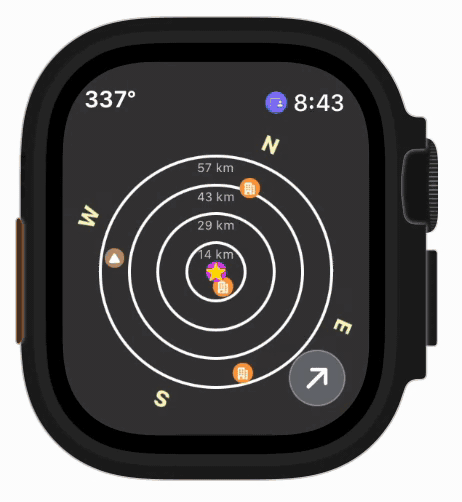
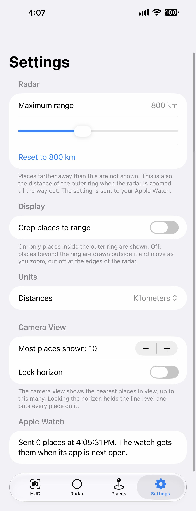

# HUDViewWatch
November 2026\
Stuart Rankin

HUDViewWatch merges two apps into one, for iPhone and Apple Watch:

- **HUDViewUI** (UIKit): a camera view with a horizon line, a compass bar and points of interest (POIs) drawn over the picture.
- **POIView2** (SwiftUI): a radar of POIs for iPhone and Apple Watch, with an editable list of places that is sent to the watch.

Everything either app could do is here, and each app's features are available to the other's code. HUDViewUI's screens were rewritten
in SwiftUI; its storyboard and view controllers were not carried over. The only UIKit left is the camera preview layer, which SwiftUI
cannot show by itself (`CameraPreview.swift`), and reading the interface orientation.

The goal was to bring the watchOS app and merge it with the existing HUDView functionality. I did this with Claude and a great deal of testing.

In a sense, HUDViewWatch is the logical successor to HUDView, HUDViewUI, and POIView2.

The app on the phone shows the most information, as expected:

This is a live view with a HUD overlay with points of interest along the current bearing.\

This is a view from an Apple Watch (a different session from the animation above) showing the same data, but in a radar plot. The digital crown is used to zoom in or out.\

## Main HUD View
The HUD view shows a live view and a line that represents the horizon. The line is always horizontal in relation to the Earth, not the phone. POIs show up in the direction that the phone is pointing.\

The image above shows:
1. At the top, a compass showing bearing degrees and cardinal points.
2. A yellow view showing the current heading and cardinal direction.
3. The live view. This has a red line as the horizon, which in our example is at a slight angle since I was holding the phone at a slight angle. There are several POIs in the live view along the bearing I pointed the phone.
4. Near the bottom is a small overlay of controls.  The first button changes from the back to the front camera, the second button locks the horizon (and moves all POIs to the horizon) relative to the phone, not the phone's orientation, and the third button locks the view and displays information about the current location.
5. The bottom section selects other view and is discussed in the next section.

## Tabs (iPhone)
| Tab | What it does |
| :--- | :--- |
| HUD | Camera with horizon line, compass bar, heading, and the nearest places in view. Buttons: switch camera, lock the horizon, show location, open the radar. |
| Radar | Radar with range rings, a pulse at your position, pinch/slider zoom, tap to select, and a count of places in range. |
| Places | Add, edit, delete, show or hide places, including the built-in ones. Changes go to the watch. |
| Settings | Maximum range, crop to range, distance units, camera view options. |

Tapping a place on the camera view or on the radar selects it in both.

## Apple Watch
The watch shows the radar (Digital Crown zooms), the heading when no place is selected, and the place details when one is. It receives
places, hidden places, range and units from the iPhone. The radar is sized to fit every watch size. The animation above shows the bearing of the points of view change as the user changes direction.

## Places
Settings is only available on the iPhone. Any settings that pertain to the Watch are set in the phone app and transmitted via standard API calls.

The Places/POI editor.\

This page lets you create your own set of POIs for the app. The app comes with a set of test POI that can be disabled at will (by tapping the eye image next to the built-in place).

## Settings
Settings is only available on the iPhone. Any settings that pertain to the Watch are set in the phone app and transmitted via standard API calls.

Settings page for HUDViewWatch (artifically stretched to get everything to fit)\

### Send to Watch Now
Tapping this sends any changes or new places to the companion watch app.

### My Places
This section will show your POIs, if any.

### Build-in Places
This section shows the built-in test places. Tap the eye icon next to a place to hide it.

#### Editing
You can delete places by tapping the Edit button and using the standard iOS methodology to delete entries. (Deleting a built-in POI merely hides it.)

#### Adding
To add a new place, tap the **+** button in the upper right. That will open the POI creation view.\

Most of the fields are self-explanatory. You can select a place on a map with **Choose on Map** or your current location with the **Use My Current Location** button. The optional data depends on the POI type - a national park, for example, won't need a population.

### Maximum Range
This determines which points of interest are displayed. Only those POIs within the range will show up. This is shared with the watch.

### Crop places to range
If true, the radar view on the phone will not display any POIs outside of the outer radar ring. Otherwise, the POIs will show outside the radar rings. This does not effect the watch - the watch will always crop POIs to the radar ring.

### Units
Self explanatory.

### Camera View
#### Most places shown
This sets a limit on how many POIs are shown on the HUD view at a given time. This is a performance settings and can be adjusted as per your preferences and hardware.
#### Lock horizon
When true, the horizon line is locked to the center of the HUD view and all POIs are shown along that line. If false (default), the horizon line will always be parallel with the tangent on the Earth where the phone is over (eg, your location) regardless of the orientation of the phone. POIs will adjust location as well.

### Apple Watch
Shows the status of the last data transmitted to the watch.

## What came from where
| Feature | From |
| :--- | :--- |
| Camera view, horizon line, horizon lock, selfie camera | HUDViewUI |
| Compass bar (16 points), location card | HUDViewUI |
| Earth-curvature elevation, pinhole projection of places | HUDViewUI (`Shared/HUDMath.swift`, now tested) |
| Metric / imperial distances | HUDViewUI (`Shared/DistanceUnit.swift`) |
| Radar pulse and in-range count | HUDViewUI |
| Place descriptions, the extra built-in places (Lake Tahoe, Mexico City, Washington DC, Home) | HUDViewUI |
| Place list, editor, map picker, edited copies of built-ins | POIView2 |
| Show/hide a place, overlap culling, range and crop settings | POIView2 |
| Watch app and WatchConnectivity sync | POIView2 |

Route waypoints from HUDViewUI are not included, as in POIView2.

## Layout
- `Shared/` is compiled for both iPhone and watch: models, store, radar, `HUDMath` (camera and horizon math), units, sync.
- `HUDViewWatch/` is iPhone only: the tabs, camera, motion, HUD screen.
- `HUDViewWatch Watch App/` is the watch screen.
- `HUDViewWatchTests/` holds the unit tests (radar, store, settings, HUD math, units).

## Requirements
iOS and watchOS 27. The user must allow location and camera. The iPhone's compass, motion sensors, GPS and camera are used.

## Testing notes
The camera, motion and compass do not exist in the Simulator. There the HUD shows a black background, a level horizon and a heading of
0°, so the places can still be seen. The projection and horizon math are covered by unit tests; the live camera view needs a real
iPhone to check.
